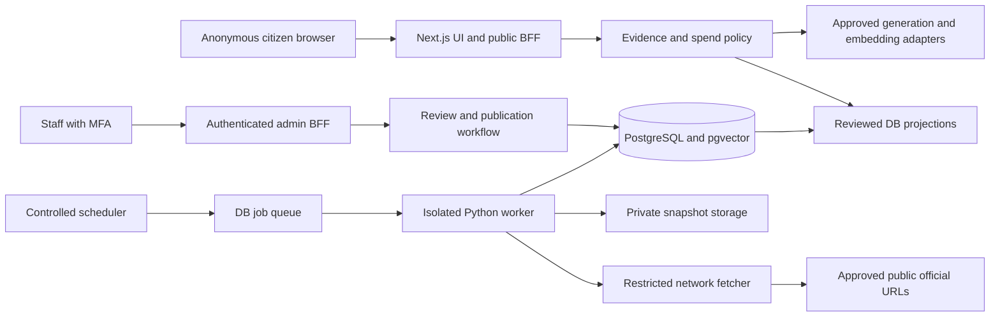

# System architecture and contracts

Pre-Phase-9 audit: minimal `POST /api/v1/feedback` now supports development-only
structured reports (category, locale, consent, optional page/published service or
source ID). No free text/contact/question/answer content is accepted or stored.
The separate askbd_feedback role can only invoke the bounded enqueue function;
askbd_web remains read-only. Default demo form is unchanged; CHAT_MODE=api selects
the structured interface, but environment settings cannot open production intake.
Full free-text/reference/triage contracts below remain future gated extensions.
Directory-search and staff-form bodies now share fixed byte/time/UTF-8 limits.

Phase 7 completion adds a server-only reviewed-claim repository and a disabled RAG
composition, reusing existing private claim/evidence models through the read-only
`app_public.answer_support(jsonb)` decision function. No raw-table or public write
access is introduced. Exact curated support and staff recency are rechecked before
delivery. The public answers handler stays closed; see
[PHASE_7_REPORT](PHASE_7_REPORT.md) and [human review](P41_HUMAN_REVIEW.md).

The approved initial hosted-generation adapter is Google Gemini through Vertex AI,
implemented using the official Google Gen AI SDK behind the existing transport.
See [VERTEX_AI](VERTEX_AI.md). It defaults disabled; ADC/project/billing and live
approval remain gates. Retrieval, citation support checks and public routing are
unchanged. Embedding and generation interfaces remain separate.

## Phase 6 internal contracts

Current implementation and actual checks are in [PHASE_6_REPORT](PHASE_6_REPORT.md).
The Next.js frontend/BFF, private SQL evidence boundary and isolated offline model
worker remain separate. No new public evidence/chat API is introduced. Public chat
continues as a local demo; production/real-corpus gates are unresolved.

`retrieveSemanticPassages`, `retrieveHybridPassages` and `retrieveRoutedPassages`
are server-only repositories over P29's strict passage projection. Query bounds
remain 256 Unicode codepoints/32 tokens; hybrid requests have zero offset, at most
50 candidates per branch and 20 returned passages. Both branches apply eligibility
before fusion; all selected IDs are rechecked before returning a bundle.

The internal bundle includes immutable evidence, per-branch ranks/scores, fusion
and final rank, distinct freshness clocks, profile coverage, generation/evaluation
clock, policy/rank versions and optional routing diagnostics. `complete`,
`degraded`, `no_results` and `conflict_hold` describe retrieval, not an answered or
verified citizen claim. A failed database/policy check throws a sanitized unavailable
error. Missing vectors cannot masquerade as complete semantic search. Original
query context is ephemeral server-only data; it must not enter reusable citations,
public analytics, logs or persisted evidence.

The provider accepts only pinned local profiles and bounded query/passage tasks;
the database role used to generate passage vectors is separate from public reads.
`EmbeddingStore` exposes bounded reads/idempotent commits without giving callers
raw SQL/table permissions. [DATABASE](DATABASE.md) owns schema and
[EMBEDDINGS](EMBEDDINGS.md) documents the local process transport and deployment limits.

Status: Phase 0 approved by the owner on 2026-10-18. The Phase 1 local foundation
P04-P07 passed its checks; other product components remain planned and untested.
Current evidence belongs in [PHASE_1_REPORT](PHASE_1_REPORT.md) and
[CODEX_PROGRESS](CODEX_PROGRESS.md).
Phase 2 P08-P13's design and bn/en public frontend are recorded in
[PHASE_2_REPORT](PHASE_2_REPORT.md). Typed local demonstration/catalog adapters
introduce no live API, database or provider integration. Server-reviewed data
and evidence eligibility remain required for future actionable information.
P14 selects Supabase-compatible PostgreSQL/CLI for local SQL-first development;
see [DATABASE](DATABASE.md) and [P14_REPORT](P14_REPORT.md). No hosted project is
provisioned. PostgreSQL 17.11 runs locally, with twelve real core integrity tests
passing. Local startup uses an explicit loopback Docker publish; the pinned CLI
handles SQL migrations/type generation using a validated password-free local URL
and an environment-only password. The CLI's classic network default and managed
gateway exposed non-loopback listeners on this host, so neither starts services.
Phase 2 remains DB-independent.
P15 adds fourteen private provenance/evidence/review/embedding tables and pgvector
0.8.2, using two forward SQL migrations. SQL predicates prepare eligibility but
have no public grants. P16/P17 now implement Supabase staff MFA, private role and
session authorization, narrowly reviewed public metadata projections, typed
repositories and read-only directory APIs. See [PHASE_3_REPORT](PHASE_3_REPORT.md).
AI and cloud storage remain unimplemented; no hosted project exists. Phase 5's
local ingestion implementation is described below; live collection stays disabled.
See [DATABASE](DATABASE.md) and [P15_REPORT](P15_REPORT.md).
Technical references checked 2026-10-18. Product requirements are in [PRD](PRD.md),
entity definitions in [DATABASE](DATABASE.md), and publication rules in
[SOURCE_POLICY](SOURCE_POLICY.md).

## P22–P28 implemented ingestion boundary

P29 now adds an internal lexical evidence repository, described in
[P29_REPORT](P29_REPORT.md). `retrieveKeywordPassages` is server-only and uses the
existing pooled askbd_web connection plus a narrowly granted SQL projection.
It adds no route, chatbot API, model, worker or public UI. Existing directory
name/alias search is preserved. The SQL function joins reviewed source metadata
and rechecks the requested current passage's approval/freshness/conflict guards;
raw tables remain private. Query text/original trace context exists only in request
memory, with no cross-request cache or persisted questions. Retrieved text remains
untrusted data and its score is not claim verification.

Internal input: query (1–256 Unicode codepoints, at most 32 application word
groups), locale bn/en (default bn), limit 1–50 (default 10), offset 0–500,
optional service_id/agency_id/source_id UUIDs and passage language filter.
No caller can override eligibility. SQL independently validates bounds, parses
literal non-stemming lexemes and caps 64 unique terms. OR matching finds partial
token overlap; phrase and context signals rank it. There is no fuzzy/prefix/
stemming, transliteration, alias expansion or semantic branch in P29.

Output contains bounded immutable passage/document/version/source/agency IDs,
exact stored document URL/title, original passage text, page/section/character
locators, hashes/profile, known official dates, separate ownership/document-review/
content-check clocks, score components, rank/policy versions, evaluation time and
publication generation. Unknown dates/page labels remain null. No private proof,
reviewer identity, review notes, storage keys, embeddings or raw locator JSON is
returned. Original query is separate ephemeral context, not reusable evidence.

Ordering is descending normalized score then passage UUID; bounded offset pages
are deterministic within unchanged data. Eligibility is rechecked per call; a
changed corpus can shift pages. Generation/evaluation time identify that context,
but this is not a frozen snapshot or delivery authorization. Future P31 can fuse
stable IDs/ranks; delivery must independently recheck current evidence. An outage
or invalid projection raises a sanitized unavailable error, distinct from no matches.

Phase 5 preserves the single Next.js BFF and separate Python worker. No web route
fetches a source, runs a parser or starts a job. See [PHASE_5_REPORT](PHASE_5_REPORT.md)
for actual checks and [worker setup](../workers/ingestion/README.md) for local commands.

`Crawler` obtains exact-URL SQL permission before DNS and produces bounded hostile
bytes plus private manifests. `ParserSandbox` passes only bytes/type/source URL
through stdin to a local immutable-image Docker container: no network, host mounts,
credentials or arbitrary entry command. The process is unprivileged, read-only,
resource/time limited and disposable. HTML, pypdf, Poppler and Tesseract run here.
`PrivateStore` writes hash-addressed original/derivative/page-image artifacts;
`IngestionWorker.run_once()` coordinates a single leased job and defaults disabled.

Job contracts are fixed parameterized `app_worker` functions, not public APIs:
enqueue/claim/heartbeat/reserve/latest-capture/observe/complete/fail, bounded
schedule and aggregate metrics. PostgreSQL remains the only queue/migration system.
Jobs bind current policy, exact URL, UUID fence and generation; stale attempts
cannot commit. A 30-second heartbeat renews a five-minute lease, with a 15-minute
attempt ceiling. One running job per source and two globally bound parser work;
P22 still serializes every network hop with a completion gap and durable budget.

Raw text, NFC normalization maps, page/section locators and extraction profile
are preserved in private derivatives. SQL commits immutable versions/passages and
a review-blocked indexing outbox atomically; storage writes precede SQL and may
leave private unreferenced objects after failure. No indexing consumer, embeddings,
retrieval or AI exists. Publication requires independent fresh-MFA human review,
append-only passage decisions and the existing source/domain/freshness predicates.
Changed bytes/redirect identity suppress old current guidance before parsing.

Operational scheduling is an explicit bounded SQL call, with no daemon/cron or
live command installed. Controls default paused; the Python runtime independently
defaults disabled. Production egress, object-store IAM/retention, source permissions,
review staffing and explicit activation are separate gates. This is local
implementation readiness, not operational source coverage.

## P18 implemented registry boundary

P18 adds a private source-registry workflow to the existing BFF and SQL functions;
it does not add a service, ORM or provider. See [P18_REPORT](P18_REPORT.md) for
execution evidence and [SOURCE_POLICY](SOURCE_POLICY.md) for review rules.

Protected contracts: `POST /api/v1/admin/sources` creates a candidate;
`GET /api/v1/admin/sources/{id}` reads selected private review metadata;
`PATCH /api/v1/admin/sources/{id}` replaces editable descriptive metadata;
`POST /api/v1/admin/sources/{id}/{submit|approve|activate|reject|suspend}` performs
one explicit transition. Mutations require strict JSON, a reason, an UUID
Idempotency-Key and, except creation, a decimal-string revision. Creation accepts
agency_id, url, source_name, description, language, source_type, risk_class and
reason. Approval requires separately evidenced ownership, authority, content-use
and accessibility assertions. Full field/error contracts are in the P18 report.

Route Handlers validate/authenticate; server-only repositories parameterize calls
to app_staff.registry_command/registry_read. SQL repeats authorization, revisions
and lifecycle validation and atomically appends audit/outbox plus retry records.
Responses use `{data,request_id}` or `{error:{code,message},request_id}` and are
private/no-store. Reads return at most 20 verification and 50 event records;
full immutable history remains private. No registry collection/dashboard exists.

Public directory contracts and the Phase 2 demo remain unchanged. New registry
activation only creates reviewed metadata releases; all pre-existing eligible
current-document, agency/domain, freshness and privacy gates still apply.
No document, claim, citation or crawler authorization is generated by approval.
No URL is fetched or DNS-resolved. Future ingestion must enforce its independent
network, path-scope and permission controls. P19 and later work are not included.

## P19-P21 implemented directory contracts

The owner authorized the remaining Phase 4 implementation/tests only. The public
UI now supports explicit server-only DIRECTORY_MODE=published; default demo needs
no DB. Homepage navigation and existing bn/en list/detail routes switch together
at request time. Published mode reads the same reviewed projections as the APIs,
uses no public caching and never falls back to synthetic/demo content on failure.
Section/detail/home routes are dynamic to avoid capturing runtime mode and trust
state at build time; shared assets remain cacheable. See [PHASE_4_REPORT](PHASE_4_REPORT.md).

P19 protected routes: POST /api/v1/admin/directory/{agencies|categories|services},
PATCH /api/v1/admin/directory/{kind}/{uuid}, POST of publish/withdraw beneath a
record. They reuse online MFA, bound SQL sessions, strict JSON/revision/retry keys,
existing actor budgets and append-only staff audit/outbox. Independent identity
metadata publication requires current proof and five-minute fresh MFA. This is
not document publication or an administrative dashboard. Exact fields are in the
Phase 4 report and app validation schemas.

POST /api/v1/search now implements **directory metadata keyword search only**,
not passage search/retrieval/AI. Body: locale bn|en, query up to 120 characters,
limit 1–50 and optional category slug, agency_id, cursor. Queries stay out of URLs,
logs, stored records and raw cursor payloads. Search/filter bindings are hashed
with canonical property ordering and a policy revision; signed cursors expire
and are invalidated by publication generation changes. Response is the existing
directory envelope. GET source collections additionally accept service_id;
service metadata may include approved/eligible source_ids. Text remains escaped
and descriptions/review evidence are not public identity metadata.

P21 protected GET /api/v1/admin/directory/integrity returns bounded aggregate
diagnostics. POST /api/v1/admin/sources/{uuid}/link-check accepts revision/reason
and retry key, then records NETWORK_POLICY_NOT_READY with checked_at=null. It
does not perform network I/O. Private source GET includes health/latest 20 link
checks. The isolated worker owns future egress, destination-IP/peer/redirect and
permission enforcement. No BFF proxy, fetch URL, scheduler or network-enable flag
was introduced. Reachability history cannot renew document evidence or change
ownership/crawl approval. Public links with review flags are withheld.

## Decisions and alternatives

P22 implements the isolated Python retrieval boundary beneath workers/ingestion;
see [P22_REPORT](P22_REPORT.md) and the [worker guide](../workers/ingestion/README.md).
It is an explicit one-document library, with no web fetch endpoint, scheduler,
recursive discovery or automatic live execution. SQLRegistry calls only the
app_worker policy/reserve/finish functions through a dedicated pg8000 connection.
Existing SQL migrations remain the sole schema authority. The pure-Python driver
avoids the installed MSYS2 interpreter's missing libpq/native-wheel dependency;
it adds no ORM or provider. Exact runtime/transitive pins are in requirements.txt.

Source approval is insufficient: an independent, fresh-MFA staff SQL review must
approve exact document/redirect URLs, terms/permission proof, expiry and budgets.
Policy binds source/domain/reviewer revisions. Worker cannot approve a source,
publish evidence, read raw tables or administer staff. Reservations serialize
all worker HTTP hops with a 60-second lease and five-second global minimum gap;
robots, redirects, failures and abandoned requests count against a rolling 24-hour
source budget. Source revisions and approval are rechecked per hop and delivery.

The stdlib HTTPS transport resolves once, rejects any unsafe/mixed/IPv6 answer,
connects a numeric IPv4 socket, validates its peer before HTTP and after TLS,
and retains normal certificate validation/SNI for the approved hostname. There
is no proxy/environment/cookie/credential fallback. Header/body/framing bytes,
absolute deadline, cancellation and redirects are bounded. Every redirect repeats
scope, robots, source, DNS and peer gates. Robots is fetched anew per document;
unsupported rule syntax pauses retrieval. Retrieved bytes remain untrusted,
ephemeral quarantine input; metadata/hash does not publish or renew evidence.

The library defaults to DISABLED. No production egress policy has been provisioned
or verified; isolated deployment, independent network denial, real permission
review and explicit live authorization are prerequisites to runtime enablement.
Tests use simulated transport and real disposable PostgreSQL only. P21's BFF
link-check endpoint remains disabled and is not silently wired to this library.

| ID | Proposed decision | Reason and reconsideration trigger |
| --- | --- | --- |
| ADR-01 | Modular Next.js App Router application with TypeScript and server-side BFF | One deployable web/API unit; split services only when independent scaling/security ownership warrants it |
| ADR-02 | PostgreSQL plus pgvector, lexical search, and pg_trgm | One transactional evidence store and retrieval engine; add a search service only after measured recall/latency limits |
| ADR-03 | Isolated Python ingestion worker and durable PostgreSQL jobs | Parsers/OCR need different dependencies and resource limits; no Redis/Kafka initially |
| ADR-04 | Private object storage for immutable originals and extraction artifacts | Preserve evidence lineage outside relational rows; never publish a bucket wholesale |
| ADR-05 | Separate replaceable generation and multilingual embedding interfaces | Quality, retention, price, and index compatibility must be evaluated independently |
| ADR-06 | Anonymous informational access; authenticated staff administration | Avoid citizen account friction and collection; future accounts cannot become a prerequisite |
| ADR-07 | Publish reviewed evidence, validate citations before delivering generated facts | Trust is a policy boundary, not a prompt instruction alone |
| ADR-08 | Supabase is an optional managed PostgreSQL/storage/admin-auth bundle | Reduce operations if grants, RLS, backup, region, and plan limits pass review; portable SQL/storage interfaces remain required |
| ADR-09 | Tailwind CSS 4 and selected shadcn/ui components, pending browser decision | Compatible documented ecosystem; public-device coverage may instead require scoped plain CSS or another maintained styling approach |
| ADR-10 | SQL-first migrations via pinned Supabase CLI in P14; generated schema types after DB verification; Python DB client later | One SQL authority; Phase 1 deferred tooling, P14 selects it; no ORM or parallel migration runner |

The owner authorized the P04 local foundation using this architecture. These
long-term decisions do not independently authorize provisioning or deployment.
Do not start with microservices, Kubernetes, a separate vector database, autonomous
agents, browser automation of government portals, or a citizen identity database.

## Current stack compatibility findings

| Area | Official evidence and implication | Open validation |
| --- | --- | --- |
| Next.js | [App Router installation](https://nextjs.org/docs/app/getting-started/installation) documents Node >=20.9, TypeScript >=5.1, and separate lint execution; minimum versions are not maintenance recommendations | Pin a patched supported Next/React/TypeScript set and run build, typecheck, and lint independently in Phase 1 |
| Node | [Node releases](https://nodejs.org/en/about/previous-releases) lists Node 24 as LTS and Node 20 as EOL on the check date | Propose Node 24 LTS; verify tools and hosting support before pinning |
| Styling | [Tailwind compatibility](https://tailwindcss.com/docs/compatibility) specifies Chrome 111, Safari 16.4, Firefox 128; [shadcn/ui](https://ui.shadcn.com/docs/tailwind-v4) documents React 19/Tailwind 4 support | Device research and browser acceptance are required; no claim of universal low-end-device support |
| Retrieval | [pgvector](https://github.com/pgvector/pgvector) documents exact and approximate search, filtered ANN recall limitations, and index dimensional limits | Extension version, dimensions, memory, filtered recall and query plan must be measured on the actual host |
| Text search | PostgreSQL [simple dictionary](https://www.postgresql.org/docs/current/textsearch-dictionaries.html) and [pg_trgm](https://www.postgresql.org/docs/current/pgtrgm.html) provide lexical primitives | No Bangla stemming/segmentation quality is assumed; evaluate Unicode tokenization and Banglish aliases |
| Managed DB | [Supabase pgvector](https://supabase.com/docs/guides/database/extensions/pgvector) documents extension support | Actual PostgreSQL/extension versions, quotas, pooler, available regions and backup capabilities remain unknown |
| Extraction/OCR | Python + Trafilatura and Tesseract are candidate tools; PyMuPDF needs AGPL/commercial license review | See [DEPLOYMENT](DEPLOYMENT.md) for primary references, Python floor, license alternatives and parser sandbox checks |
| Test stack | Vitest, Playwright, Pytest are proposed and have separate runtime constraints | See [EVALUATION](EVALUATION.md); Phase 1 resolves one compatible locked toolchain, not blindly installing latest packages |

Use a currently maintained PostgreSQL major available on the approved host; the
reference pages resolving to PostgreSQL 18 do not establish that host's version.
No material fundamental stack incompatibility is established by documentation,
but licensing, browsers, extension availability, and runtime/tool pins are gates.

## Components and trust boundaries



The browser has no database admin, worker, storage, or provider secret. The BFF
uses a dedicated least-privilege DB role and reviewed projections/functions.
Direct public database access is disabled initially. Staff session verification
and object-level authorization happen on every admin request, never just in UI
routing. Worker credentials cannot publish or administer staff.

Government sites and all document bytes are untrusted inputs even after domain
ownership verification. External model output is also untrusted. The model has
no fetch, SQL, filesystem, credential, or transactional tools. Provider requests
contain only bounded user input and approved public passages, subject to the
privacy policy. Extraction has no unrestricted network or runtime privileges.

## Planned module boundaries

The future layout is illustrative, not a scaffold created in Phase 0:

| Module | Responsibility |
| --- | --- |
| web experience | Localized server-rendered directory/guides; narrowly scoped interactive chat and filters |
| catalog | Service/agency metadata and evidence-backed service pages |
| registry/policy | URL identity, official verification, check schedules, publication eligibility, revocations |
| retrieval | Normalization, language variants, lexical/vector candidate fusion and optional reranking |
| answers | Spend admission, bounded prompt assembly, structured generation, claim/citation validation |
| admin | Source review, conflicts, feedback, jobs, publication, operational controls and audit |
| ingestion worker | Fetch, extraction, OCR, canonicalization, versioning, chunking, indexing jobs |
| observability | Redacted operational events, aggregate analytics, spend and reliability alerts |

GenerationProvider supports bounded structured completion with explicit model,
timeout, token limit, usage and retry metadata. EmbeddingProvider returns vectors
with model revision, dimensions, normalization and metric. Extractor returns
text, page/heading locators, offsets, quality flags and tool versions. Queue
supports idempotent enqueue, lease, heartbeat, completion, retry and dead letter.
Interfaces do not imply a vendor has been selected or quality validated.

## Evidence lifecycle and ingestion

1. Staff nominate a public URL; prove agency ownership and precise approved URL
   scope. Hostname suffix alone is insufficient. No arbitrary citizen URL fetch.
2. A scheduler creates a deduplicated due check. Fetcher validates DNS, every
   redirect and destination, TLS, robots/access rules, MIME and byte/time limits.
3. Store hash-addressed private original bytes and a complete safe fetch manifest.
   A failed attempt records failure, not renewed evidence freshness.
4. Extract HTML with Trafilatura or native PDF text with the approved PDF parser.
   Use isolated Tesseract Bengali/English OCR only for pages needing it; retain
   page provenance, OCR flags, tool versions and digit/table review warnings.
5. Normalize conservatively; preserve original text and an offset mapping. Build
   versioned passages by headings/pages/semantic boundaries, keeping table context.
6. Identify changed facts, effective dates, scope, duplicates and possible conflicts.
   Machine detection raises review work; it never chooses authority automatically.
7. Reviewer approves document version, locator integrity, claim evidence and risk.
   Embedding jobs record profile/version. Staged artifacts are never queryable publicly.
8. Publish atomically with a revision increment, audited actor and invalidation.
   Old versions remain private for authorized audit, subject to retention/removal rules.
9. Recheck on schedule; suspend/revoke sources, versions or claims when necessary.
   Freshness expiration is evaluated at request time even if the scheduler is down.

The complete eligibility rule and proposed freshness windows live in
[SOURCE_POLICY](SOURCE_POLICY.md). Shared minimum: active verified source,
reviewed published current document version, unexpired applicable check and
verification, effective applicability, no unresolved relevant conflict, and no
revocation. Review approval does not renew a fetch timestamp.

A changed digest immediately quarantines affected current guidance pending review;
the previous digest's remaining TTL is not permission to keep serving changed
requirements. Explicit withdrawal/404/410 suppresses affected evidence immediately.

Use a transactional outbox for index/invalidation work; a failed background
invalidation cannot make revoked evidence eligible. Search predicates enforce
eligibility; answer delivery rechecks the current policy revision and evidence.
If evidence changes during generation, reject or regenerate once within budget.
During policy/DB outages, suppress factual answers and actionable cached content.
Any retained shell may show only clearly unavailable states and safe independent
product content. Do not serve stale actionable guidance as an outage fallback.

## Retrieval and answering

Keep original query transiently, detect language/code switching, produce bounded
conservative normalization and optional Banglish variants, and request clarification
where transliteration could alter intent. Never normalize identifiers into new
facts. Retrieve lexical/simple/trigram and semantic candidates with the same
eligibility predicates. Start with exact filtered vector search for a small corpus;
benchmark before adding HNSW. ANN SQL filters do not guarantee physical prefiltering.

Fuse ranks (proposed RRF), deduplicate version/near-duplicate passages, preserve
jurisdiction/applicability, and assemble a bounded evidence set. Follow
[AI_SYSTEM](AI_SYSTEM.md) for candidate sizes, prompt rules and validation.

The model may reference only provided evidence IDs. Bind citation URLs from the
registry on the server; validate every ID, version, quote/locator and actionable
claim. Deterministic binding checks are necessary but do not prove semantic
entailment. Human-reviewed evaluation and claim checks address that residual risk.
For initial launch, fees, deadlines and eligibility assertions must select reviewed
`service_claims` with eligible `claim_evidence`; generation may phrase those atoms
but cannot introduce new values or conditions. Extend this curated pattern to other
critical required-document/procedure assertions when review risk warrants it.
No raw generated factual tokens are streamed before validation. Informational
progress events may precede a completed validated answer.

## Public API contract (planned v1)

The directory/search and closed question foundations implement subsets below;
structured feedback has a development-only intake. Full generated-answer,
guide-evidence, citation lookup and richer feedback remain gated. Use JSON UTF-8, UUID
identifiers, ISO-8601 UTC timestamps, HTTPS and a server-generated `request_id`.
`locale` accepts `bn|en`; `answer_language` accepts `auto|bn|en|banglish`.
User-provided IDs/filters never authorize hidden records. Text is escaped at render;
model HTML, arbitrary Markdown links and scripts are never executable.

Machine surfaces: `/robots.txt` and `/sitemap.xml` expose only approved public
indexing policy/URLs; never list admin, preview, query, session, upload or expired
citation resources. `/health/live` reports process liveness; `/health/ready` returns
only coarse ready/unavailable state, with detailed dependency status authenticated
under admin. Health checks never trigger paid calls or government-site fetches.

### Read endpoints

| Endpoint | Request | Response |
| --- | --- | --- |
| `GET /api/v1/services` | locale, category, agency_id, cursor, limit | published metadata items, next_cursor, policy_revision |
| `GET /api/v1/categories` | locale | reviewed service taxonomy tree; no user-specific data |
| `GET /api/v1/services/{slug}` | locale | metadata, supported claim blocks and citations, availability and review dates; omit unsupported details |
| `GET /api/v1/agencies` / `{slug}` | locale, cursor, limit on collection | reviewed identity/metadata and verified official navigation |
| `GET /api/v1/sources` / `{id}` | cursor, limit on collection | sanitized registry identity, current status/check dates, evidence method; no private snapshots/reviewer personal data |
| `POST /api/v1/search` | JSON q, locale, category, agency_id, cursor, limit | eligible service/passage hits with official citation metadata and bounded snippets |
| `GET /api/v1/services/{slug}/guide` | locale | ordered reviewed primary guide with claim citations and applicability; routes authored in Phase 2, actionable content only after Phase 5 evidence |
| `GET /api/v1/citations/{id}` | none | eligible citation locator/short excerpt, or 410 if withdrawn; never exposes private storage paths |

Search uses POST despite being read-only: keep question/search text out of URL,
browser history, referrer and access logs. The public `/[locale]/search` page keeps
query state transient; only nonidentifying filters may appear in its URL. Redact
request bodies in all middleware/proxies. `q` is at most 500 Unicode code points.
P17 collections use `{data:[],meta:{limit,next_cursor,policy_revision},request_id}`;
details use `{data:{...},meta:{policy_revision},request_id}`. Directory identity
metadata has `coverage:metadata_only`, no procedural text or claim citations.
Sources additionally expose `evidence_eligible:false`; no public passage API is
enabled. Categories also support bounded paging and detail-by-slug. Unknown query
parameters, sorting, offsets, duplicate keys and free-text GET searches are denied.
Default limit 20, maximum 50; opaque
cursors bind normalized filters, policy revision and stable order. Expired cursors
return 400 with `CURSOR_EXPIRED`, allowing restart. P17 cursors are HMAC signed
using a server-only 32–64-byte hex CURSOR_SIGNING_KEY and expire after 30 minutes.
Empty result sets return 200,
not invented suggestions. A citation detail endpoint serves only explicitly
public retained artifacts; answer citation fields remain usable within the session
even if a transcript was never stored. Public citation records follow audit retention.

### Answer endpoint

P40 supersedes the earlier P35-only restrictions below: six bounded transient
history items, 8,000 total code points, 40 KiB streamed JSON, two-second body and
20-second API deadline. Only prior user intent informs follow-ups. Structured
answer contracts and API UI exist but production remains closed; see
[PHASE_7_REPORT](PHASE_7_REPORT.md) for exact provider/support/publication gates.

P35 implementation note (2026-10-23): the validated foundation now exists with
production closed and no generated content. See [P35_REPORT](P35_REPORT.md) for
actual limits/response fields. Full history and generated answers below remain
downstream targets, not currently enabled behavior.

`POST /api/v1/answers` request:

```json
{
  "question": "<citizen question>",
  "answer_language": "auto",
  "history": [{"role": "user", "content": "<optional prior turn>"}]
}
```

Question: nonempty, at most 2,000 Unicode code points. Optional transient history:
up to six `user|assistant` messages, at most 8,000 total code points including the
question; no caller-supplied system messages or trusted prior citations. Previous
assistant text is context only and must be re-grounded. No cookies/account needed
for basic questions. Inputs undergo sensitive-data warning/minimization and rate
limits; caps and abuse thresholds are policy-configurable and tested later.
The proposed overall answer deadline is 20 seconds including retrieval, optional
regeneration and validation; the tighter EVALUATION p95 target is separate.
Cancellation is best effort and does not prove a provider incurred no charge.

Response shape (placeholder values are not service evidence):

```json
{
  "answer_id": "<uuid>",
  "request_id": "<uuid>",
  "status": "answered",
  "language": "bn",
  "blocks": [{"id": "b1", "text": "<validated explanation>", "citation_ids": ["<citation-uuid>"]}],
  "citations": [{
    "id": "<citation-uuid>",
    "source_id": "<uuid>",
    "document_version_id": "<uuid>",
    "passage_id": "<uuid>",
    "title": "<reviewed official document title>",
    "agency_id": "<uuid>",
    "agency_name": "<reviewed publisher name>",
    "url": "<verbatim approved document URL>",
    "locator": {"type": "pdf", "page": 1, "start": 0, "end": 100},
    "checked_at": "<ISO-8601 UTC>",
    "effective_from": null,
    "effective_to": null
  }],
  "reason_codes": []
}
```

Allowed statuses: `answered|partial|abstained|unavailable`. `partial` includes only
safe supported parts with clear limits. Reason codes include `insufficient_evidence`,
`ambiguous_request`, `stale_evidence`, `source_conflict`, `budget_exhausted`,
`provider_unavailable`, `policy_unavailable`, `validation_failed`, `out_of_scope`.
Abstention never includes guessed requirements. A clarifying question is a notice
block with no actionable claim. No unsupported confidence percentage is exposed.

PDF locator pages are 1-based; start/end are half-open Unicode code-point offsets
within the stored extracted page text. HTML locators use type `html`, heading_path,
start/end within immutable extracted version text; optional reviewed selector is
supplementary. Citations do not invent URL fragments. Checked dates are evidence
checks, not retrieval or generation timestamps.
Agency labels come from reviewed identity records. Effective dates remain null
when unknown and are displayed only when official evidence establishes them.
The example is illustrative schema data, not a valid source/citation fixture.

`answered`, `partial`, and evidence abstentions return 200. Rejected input 400/413;
rate limiting 429; budget/provider/policy outages 503 with `unavailable` answer
envelope and safe notice. All 429/503 responses include bounded Retry-After when
known. Never count an unavailable answer as a successful supported response.

### Feedback and administrative changes

`POST /api/v1/feedback` accepts optional answer_id, citation_id or service_id,
category `incorrect|outdated|missing_source|accessibility|other`, and optional text
(2,000 code points maximum). Returns 202 and opaque feedback_id. No contact field
at launch; warn against including personal details. Validate references where
available without requiring stored conversation text. Use same-origin/CSRF and
abuse protection; public feedback is never immediately published.

Proposed authenticated staff endpoints under `/api/v1/admin`:

| Operation | Contract and permission |
| --- | --- |
| sources create/update/verify/suspend | Source reviewer; allowlisted URL scope; ownership evidence; audited reason |
| documents review/publish/revoke | Content reviewer/publisher; version IDs and expected revision; no self-approval for critical changes |
| jobs enqueue/retry/cancel | Operator; approved source ID, bounded job type; never arbitrary fetch URL/command |
| conflicts resolve | Trust reviewer; evidence, applicability and rationale required |
| feedback triage | Support reviewer; redact personal details before attachment to content work |
| usage/health read and spend-policy update | Operations read; budget owner writes capped policy; no secret values returned |
| audit read | Auditor; bounded queries; no mutation/delete endpoint |

All mutations require authenticated capability checks, CSRF protection, an
Idempotency-Key where retries can duplicate work, and an expected `revision`.
Return 409 on conflicting revisions; replay identical key/payload results and
reject reuse with a different payload. Transactional audit and outbox records
commit with the change. Staff actions cannot bypass SOURCE_POLICY eligibility.

Errors use `{error:{code,message,request_id,details?}}`; never reveal stack traces,
queries, provider secrets or unpublished source content. Standard 401/403/404/409/
422/429/503 semantics apply. Before Phase 3/4 implementation, materialize these
contracts into shared schemas/OpenAPI and test permission/validation boundaries.
Future audio, uploads, profiles and transactions require separately versioned
contracts, consent, retention and authorization review; none is enabled in v1.

## Reliability, scale and spending

Server-render directories and cache safe product assets aggressively. Published
metadata caching is bounded by policy revision and evidence expiration; never
cache personal question responses publicly. Answer text is session-only by default.
Public evidence/citation provenance can persist without question or generated prose.

Use DB transactions to reserve worst-case provider cost before each billable
generation, embedding, OCR service or retry. Reconcile actual usage, retain
uncertain charges pending settlement, and stop on missing/stale price or budget
configuration. No paid call is enabled in Phase 0. Details: [DEPLOYMENT](DEPLOYMENT.md).

Queue rows have deterministic job keys, leases, heartbeat/attempt limits, jittered
retries and a dead-letter state. Treat work as at least once; storage hashes and
unique version/profile keys make replays safe. Publish only complete reviewed
bundles. Use bounded concurrency, per-host politeness, circuit breakers and separate
OCR quotas. A lease expiring does not authorize a stale worker to commit results;
use a lease token/attempt fencing check.

Initial sizing is unknown. Measure corpus bytes/pages, embedding dimensions,
concurrent questions, per-answer usage and query plans before purchasing capacity.
Scale stateless web replicas, separate parser/OCR concurrency, DB indexes/pooling
and object storage independently. Add replicas/queues/search services only after
observed bottlenecks and consistency design. No launch SLA is promised yet;
proposed release targets and measurement methods belong to [EVALUATION](EVALUATION.md).

## Long-term extension seams

Voice uses a separate consented speech adapter, transcript confirmation, language
evaluation and audio TTL; no ambient recording. Public-document assistance uses
a private quarantined per-session ingestion path that cannot join the official
knowledge corpus or claim official verification. Optional accounts add saved items
through separately scoped tables and RLS; anonymous access remains intact.
Government transactions require official written integration authority, scoped
credentials, explicit per-action confirmation, idempotency, audit, reconciliation
and independent security review. Do not scrape authenticated portals as an API.

## Open decisions and acceptance

Resolve browser coverage, maintained dependency pins, PDF parser licensing, hosted
region/privacy terms, model/embedding quality, database extension availability,
approved budgets, launch services and staffing before relevant implementation.
Legal/privacy requirements for Bangladesh and cross-border processors require
qualified review; this document makes no legal compliance certification.

Phase 0 acceptance: every capability maps to a phase, trust rules have enforceable
boundaries, entities preserve passage lineage, contracts define honest failure
states, no vendor/site test is claimed, and Phase 1 remains gated on user review.
