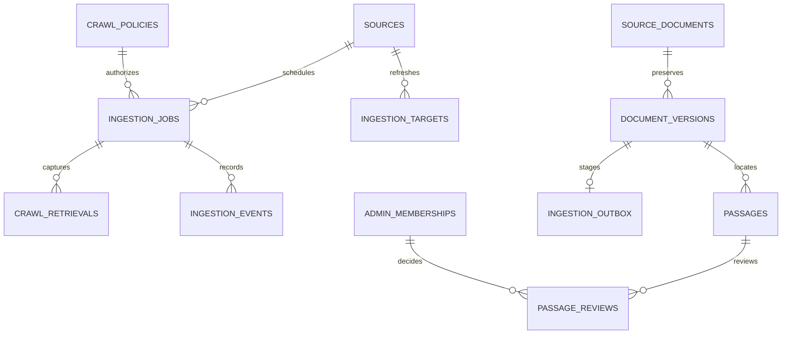
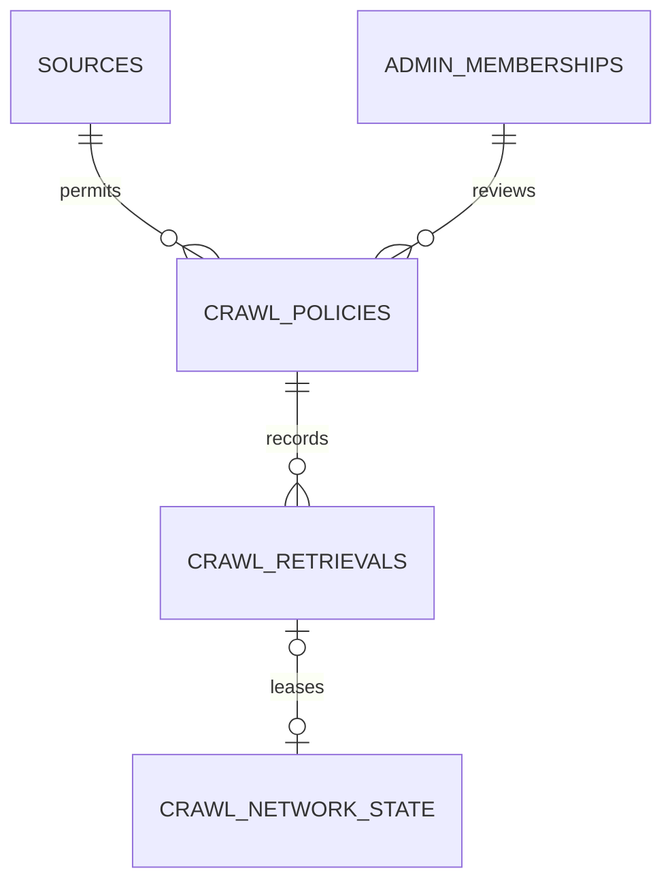
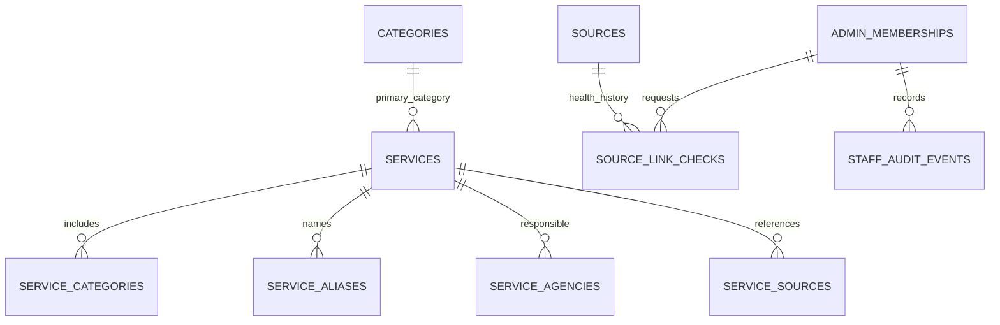
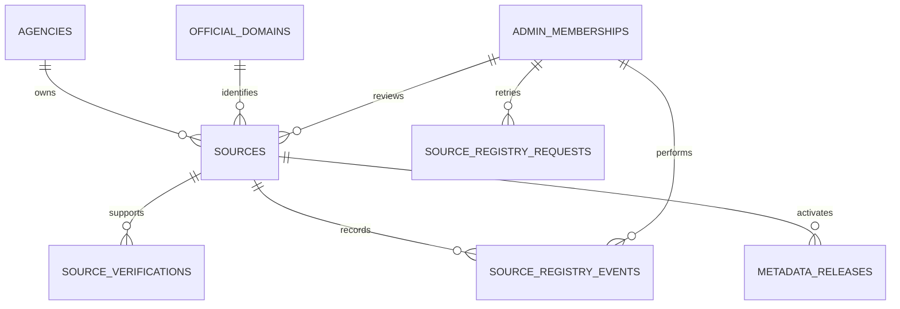
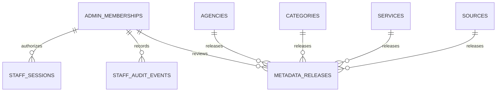
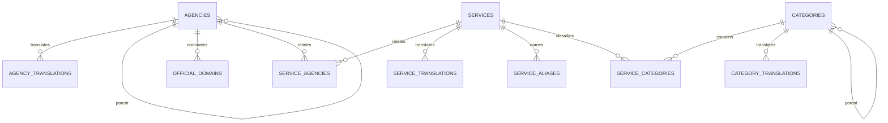
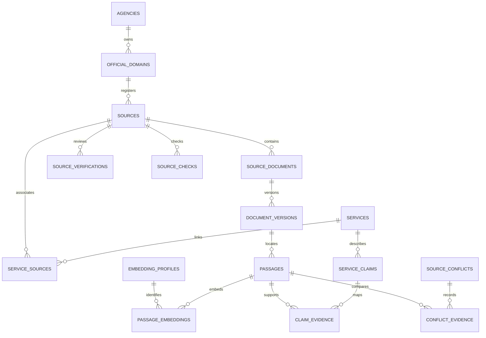
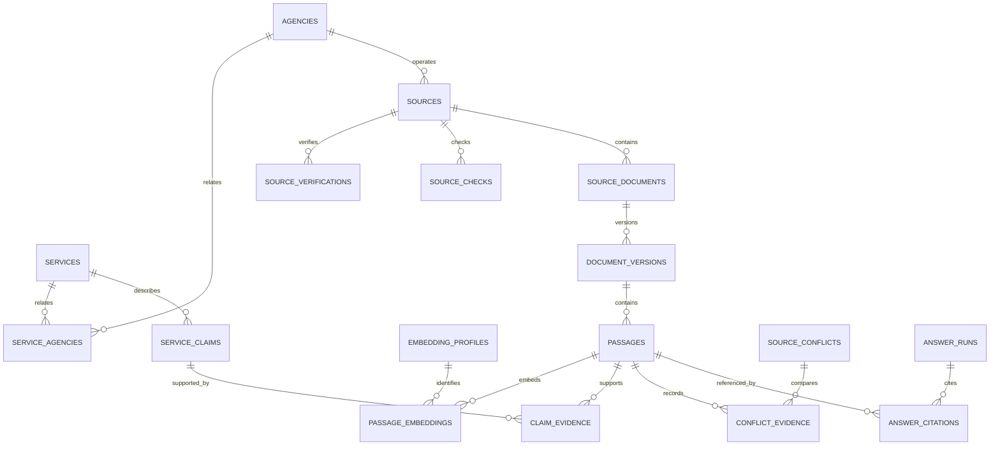

# Data model and integrity design

## Pre-Phase-9 structured feedback foundation

`20261024000100_structured_feedback.sql` and forward role-separation migration
`20261024000200_feedback_role.sql` add a private forced-RLS feedback queue. It stores
category/locale/optional page and eligible public service/source references only.
No free text, contact information, IP or chat content is stored. Optional record
references use ON DELETE SET NULL. Expiry is 90 days; expired structured metadata
is purged on the next admission. Production still needs scheduled purge/monitoring
before activation, not a claim that scheduled deletion is already operating.

Only askbd_feedback can execute `app_public.submit_feedback(jsonb)`; the web reader,
anonymous, Auth, staff and embedder roles cannot. No runtime role can read/update
the raw queue. Admission revalidates public references, serializes a 10,000-record
cap, and returns only an opaque UUID. No feedback is public or grants source trust.
Production intake is closed and operator triage UI remains Phase 9. Generated
schema types and disposable SQL tests cover this additive foundation.

## Phase 7 reviewed-claim decision projection

Forward migrations `20261023000100_answer_support_projection.sql` and
`20261023000200_answer_review_recency.sql` add/harden the bounded read-only
`app_public.answer_support(jsonb)` function. It reuses existing service_claims,
claim_evidence, current eligible retrieval projections and active independent staff
reviews; no tables or raw-table grants are added. Only askbd_web may execute it.
The output contains key/support/critical booleans, never private notes or staff IDs.
Exact text/type/language, version/hash/quote, service publication, conflicts,
applicability and review recency are checked. Critical claims need a separate
evidence reviewer. A later staff change invalidates prior reviews even if that
identity is reactivated. Nonempty applicability is withheld until explicitly
matched. See [PHASE_7_REPORT](PHASE_7_REPORT.md) for local tests and human gates.

## Current Phase 6 extension

There are **43 forced-RLS private tables / 32 SQL migrations** after P30-P34.
The new `embedding_profile_approvals` table is append-only: identity, profile FK,
enabled flag, operator membership/revision, timestamp and private note. Its trigger
requires a current owner/administrator; later membership revision/revocation or a
disable row withdraws authorization. Two immutable local candidate profiles are
registered, with zero ordinary-database approval rows. No real data is seeded.

Existing `embedding_profiles` and `passage_embeddings` remain the single vector
schema. New definer functions expose bounded eligible batches/hash-bound commits
to `askbd_embedder`, exact cosine/rechecked evidence to `askbd_web`, and reviewed
aliases/scoped conflict flags. Raw tables/vectors, private notes and model approval
writes remain inaccessible to both roles. The existing Supabase migration workflow
and generated types remain authoritative; no second migration system exists.

Exact search materializes the eligible filtered set; no approximate index can
silently lose selective-filter recall. Returned coverage counts distinguish missing
vectors. A later profile has distinct vectors even at equal dimensions; old passage
versions and embeddings cannot be overwritten by reprocessing. Operator-approved
model migration is explicit. See [PHASE_6_REPORT](PHASE_6_REPORT.md) and
[EMBEDDINGS](EMBEDDINGS.md). Counts in earlier sections are historical.

Status: **P14 PASS locally**. Ten core tables are migrated on PostgreSQL 17.11;
all twelve real migration/integrity/permission/concurrency tests pass. Generated
schema types exist. Startup explicitly binds the container to 127.0.0.1:54322;
Supabase CLI remains the sole migration/type-generation tool.
No real government records were added. [ARCHITECTURE](ARCHITECTURE.md) owns API
contracts; [SOURCE_POLICY](SOURCE_POLICY.md) owns evidence eligibility.

## Phase 5 ingestion extensions

P29 historical extension: **42 forced-RLS private tables, 28 migrations**. Three
forward files add keyword helpers/GIN/projection, correct a passage-UUID parameter
collision and normalize ranking signals consistently. See [P29_REPORT](P29_REPORT.md).
No table, ORM, provider or migration system was added. Phase 5 counts below are
historical. The generated schema remains derived from actual migrated PostgreSQL.

`passages_keyword_gin` indexes the immutable keyword_vector(normalized_text,heading)
expression, with explicit `simple` non-stemming configuration. NFC/common punctuation/
whitespace and ASCII-case normalization apply consistently to query, passage,
heading and title; original evidence fields remain unchanged. Bangla combining
marks are tested under C and the ordinary database locale; no Bangla stemmer or
cross-language retrieval quality is assumed. Trigrams/extra aliases are deferred
until justified by P33/P34 evaluation rather than widening this candidate set.

Only `app_public.keyword_search(text,text,integer,integer,uuid,uuid,uuid,text)` is
granted to askbd_web. Anonymous, authenticated, worker and staff roles lack it;
helper functions and raw passages remain denied. The security-definer function
has a fixed pg_catalog search path and uses bound values, not dynamic SQL. It
filters current eligible passage/version, complete reviewed source projection,
active document reviewer, unsafe extraction flags and unresolved related-service
conflicts. Optional service filters require reviewed published relationships;
agency means source-owning agency. No raw administrative metadata is projected.

P29 tests exposed P15/P27's passage_is_eligible argument shadowing by a lateral
passage_reviews.passage_id column. The forward fix uses `$1` explicitly and
preserves every existing policy condition. Mixed approved/pending/unknown UUID
regressions ensure one eligible passage cannot authorize another. Existing applied
migrations were not edited. This is a necessary authorization correction, not
approval relaxation.

Phase 5 checkpoint: **42 forced-RLS private tables and 25 canonical migrations**.
P22 added 009–011; P23–P28 add 012–018 in the same Supabase SQL history, with
forward verification fixes rather than rewriting applied migrations. See
[PHASE_5_REPORT](PHASE_5_REPORT.md). Inventories below are historical checkpoints.

New tables: `ingestion_controls` (singleton default paused, interval bounds),
`ingestion_jobs` (policy/source/URL, idempotency, state, attempts, lease/fence),
`ingestion_events` (append-only sanitized transitions), `ingestion_targets`
(due time/failure streak/manual hold), `ingestion_outbox` (version/profile, pending_review/
ready/cancelled), and `passage_reviews` (append-only human verdict/proof/expiry).
All deny raw web/staff/worker grants; worker functions have no publication power.
`crawl_retrievals` gains job/fence and bounded Retry-After metadata. Generated
TypeScript remains generated from the actual database, not a second schema.

`complete_ingestion` validates the live lease/current permission, successful
capture hash/MIME, exact raw-text slices, ordered locators, storage keys and strict
payload. It rejects approval fields and accepted worker passages. Same bytes and
profile reuse the version; changed profile/content creates an immutable derivative
linked through supersedes_id. Publication/effective dates remain unknown. Original
bytes and derivative JSON live in a provider-neutral private content-addressed
adapter; SQL stores references/hashes, not full snapshot bodies.

Immutable P15 passage fields stay immutable. `app_staff.review_ingestion` appends
passage decisions instead of mutating extraction quality, and requires an active
independent reviewer, bound fresh-MFA session, expected revision, current proof
and explicit acknowledgement of every extraction flag. The existing eligibility
guards still apply. Revocation clears current evidence and cancels pending indexing.
No review UI/HTTP endpoint or real identity is created by Phase 5.

Queue claims use SKIP LOCKED and fenced leases; retries have backoff/jitter and
five-attempt dead letters. Exact-URL policy changes invalidate work. Parser/security/
access failures quarantine; exhausted retries and quarantine place a durable target
hold which scheduling/enqueue cannot bypass. Fresh-MFA owner/administrator
resume_ingestion_target can clear it after review, with audit. 503 Retry-After
sets a minimum bounded delay. No worker
may change controls, approve sources or publish evidence. Owner/administrator
control changes require protected fresh-MFA SQL calls and append an audit record.

## P19-P21 directory extensions

P22 historical extension: **36 forced-RLS private tables, 18 canonical migrations**.
Three forward SQL files add crawl_policies, crawl_retrievals and crawl_network_state
and preserve verification follow-up fixes without rewriting applied history.
Execution evidence is in [P22_REPORT](P22_REPORT.md); the Phase 4 counts below
are historical. No ordinary source/policy or production identity was created.

Policies have exact URL arrays, independent reviewer/proof, source/domain/member
revision bindings, expiry, request/byte/redirect limits and immutable history.
app_staff.approve_crawl_policy requires a bound fresh-MFA review session, expected
source revision and actor-bound retry key. It cannot activate a candidate source.
The protected SQL function is not exposed by a new HTTP endpoint or dashboard.
Revocation occurs through existing source/domain/member suspension or revision;
permission expires automatically at read time. A narrower replacement can be
reviewed explicitly. No operator should substitute unaudited direct table writes.

app_worker.crawl_policy returns only eligible retrieval configuration;
reserve_retrieval checks policy again, serializes admission and counts every hop
against a persisted rolling-day budget; finish_retrieval stores bounded manifests.
The NOLOGIN askbd_worker role has EXECUTE only on these three functions, no raw
table grants and no staff/publication privileges. A separate, dedicated login
must SET ROLE; elevated logins are rejected by the Python connection helper.

Manifests preserve source/policy, approved requested/final URL, attempted/completed/
successful retrieval timestamps, status/type/size/hash, bounded cache validators
and sanitized failure. Completed records are immutable. Crash-abandoned entries
retain no completed/retrieved time and still count against budget; leases expire
after 60 seconds. No raw HTML/PDF body is stored here. Neither source_checks nor
document publication/freshness is updated by retrieval success.

Current schema: **33 forced-RLS private tables and fifteen canonical migrations**.
P19-P21 adds five forward migrations; [PHASE_4_REPORT](PHASE_4_REPORT.md) owns final
execution evidence. P18's inventory below is historical and preserved.

Agencies/categories/services gain creator/last-editor membership references.
Services gain an optional primary_category_id FK, enforced within the complete
category set by the staff command. Existing many-to-many service categories,
agencies, aliases and source relations remain authoritative; no duplicate entities
were added. Aliases normalize NFC/case plus command whitespace and remain draft
until review. Alias edits now also increment parent revisions/publication generation.
Update commands replace metadata/relationships transactionally and reset drafts.
Publication requires an independent active reviewer, current proof, fresh session
and reviewed category/responsible agency relationships. Each UI locale is reviewed
independently. New managed services fail closed on missing per-locale relations.

Existing staff_audit_events gains bounded private record/revision/reason/evidence
context and metadata/link-review outbox topics. Review proof retains method,
excerpt/reference/check/expiry. The same immutable actor-bound retry ledger and
per-actor budget serve registry and directory commands, with distinct request
hash scopes. No worker consumes outbox topics or prunes audit/retry history yet.

New source_link_checks relates source + authenticated requesting membership to
requested/checked times, outcome, failure code and evidence reference. History is
append-only, time-indexed, private and forced-RLS. It is separate from document
source_checks because those require a document and may validate content hashes.
A blocked link request has no checked time and never updates content freshness.
Three consecutive transient outcomes become suspected_broken/review-required;
one timeout/error does not permanently revoke source approval. Blocked/moved or
otherwise significant outcomes withhold source public links pending review.

app_public.directory_search owns bounded public name/approved-alias/relationship
keyword matching; directory remains a compatibility wrapper. Only these narrow
functions have askbd_web EXECUTE grants. Existing query timeouts and relationship
indexes bound work; substring search has no speculative vector/search index.
No semantic retrieval, stored citizen queries, embeddings or raw evidence exposure.
app_public.service_relations resolves exact reviewed categories/agencies/sources
for an eligible service in one query, independent of listing pagination. The BFF
deduplicates an agency's presentation when it has multiple relationship roles.

## P18 implemented registry extension

P18 historical schema: **32 private forced-RLS tables, ten canonical SQL migrations**.
Three forward P18 migrations extend sources/source_verifications and add
source_registry_events/source_registry_requests. [P18_REPORT](P18_REPORT.md)
records actual tests. Earlier P14-P17 inventories below are historical.

Sources retain immutable agency/domain/URL identity and gain private source name,
description, original submitted URL, language/type, registry review status,
content revision, creator/editor/submitter/approval/activation membership FKs and
reviewer revisions/timestamps. Availability is separate status/time/evidence.
registry_second_review_required is sticky once a source is critical; downgrading
risk cannot remove its independent second review. Legacy adopted records are
conservative. Descriptive edits reset approval and withdraw existing releases.

source_verifications gains evidence_excerpt and registry_content_revision.
Ownership/relevance records retain their own check/expiry/method/reference and
reviewer. Current proof selection binds the exact approval timestamp, reviewer
and content revision, preserving older evidence without inheriting expired proof.

source_registry_events records immutable source/actor FKs, action, old/new review
state, record revision, reason and timestamp. Its outbox_topic is
source_registry_changed; no worker consumes it. source_registry_requests records
actor/key/request hash/result, creation and 24-hour expiry. A per-actor index
supports the serialized 30-new-mutations/minute limit. No cleanup job exists yet;
the ledger preserves immutable auditability and future retention is reviewed work.
Neither runtime role has raw grants on these tables. app_staff exposes only
bound-session selected reads and narrowly checked commands.

## P14 implemented files and verification boundary

P16/P17 historical state: 30 private tables and seven forward migrations. Staff
membership/session/audit/budget tables and reviewed metadata releases/publication
generation extend the historical P14/P15 inventory below. The app_staff schema
exposes narrow session and selected-record inspection functions only to the
server-held askbd_staff role. app_public.directory is the sole web DB read
surface; the askbd_web role cannot read raw tables or private projection views.
Both runtime roles are nonowner, NOINHERIT and NOBYPASSRLS. Local Auth tooling
enables LOGIN with random local passwords; migrations contain no credentials.
All 30 tables have forced RLS. See [PHASE_3_REPORT](PHASE_3_REPORT.md) for actual
tests, roles, safe output and future onboarding limits.

`admin_memberships.auth_user_id` references externally validated Supabase identity
UUIDs, not a duplicate password store. Local Auth has a separate provider-owned
database; no cross-database FK is pretended. Session membership FK/revision,
metadata release creator/reviewer FKs and current active role checks enforce
application relationships. Existing P15 review UUID fields remain legacy private
provenance and do not independently establish a trusted public actor.

Metadata release rows pin record and translation revisions, locale, independent
active creator/reviewer, reviewer revision and expiry up to 30 days. Relationships
change service revisions; raw edits cannot inherit an earlier release. Public
source summaries require an active source, reviewed agency/domain and eligible
current document evidence. They do not expose claims, passages, arbitrary summaries,
review notes or snapshot keys. P18 now creates audited source metadata releases
through the protected activation command; P17 itself had no mutation endpoint.

See [local database workflow](../database/README.md) and [P14_REPORT](P14_REPORT.md).
Supabase CLI 2.121.0 is the sole migration tool; PostgreSQL 17 is the local target.
The P14 baseline migration is
[20261019000100_core_foundation.sql](../database/supabase/migrations/20261019000100_core_foundation.sql).
P15 migrations below share that same history. Existing `database/migrations` is
a pointer, not a competing history.

The private `app_private` schema defines agencies, agency_translations, categories,
category_translations, services, service_translations, service_categories,
service_agencies, service_aliases and official_domains. Normalized translations
and many-to-many categories preserve Phase 0; the prompt's `name_bn/name_en` and
single `category_id` examples are not duplicated as competing representations.
Multiple responsible/supporting agency relationships use a join table.

UUID identities, timezone-aware timestamps, bounded names/slugs, foreign keys,
unique relations, revision/timestamp triggers and hierarchy cycle checks are
defined in SQL. Foreign-key indexes supplement primary/unique indexes; speculative
full-text/vector indexes are deferred. Banglish aliases are search labels, not a
third translation locale. Alias normalization is NFC plus trim/lowercase, not
semantic transliteration. Canonical host identity is exact lowercase ASCII;
`www` aliases/redirect scope must be separately reviewed later.

Domain authenticity, content authority and crawler permission are distinct fields;
unknown verification remains NULL. Freshness is not inferred from record creation.
Published service metadata never establishes verified fees/procedures. All tables
have enabled/forced RLS, a maintenance-only postgres policy, no public/API grants,
and no public projection. The NOLOGIN askbd_web role is not a usable elevated
credential. Core role-denial tests now pass on real PostgreSQL.

Synthetic fixtures have a disposable-database name guard and cannot be promoted
to published/verified records; automatic seeding is disabled. No live source
documents, evidence, embeddings, auth, API or publication workflow is implemented
in P14. P15 now implements the private evidence subset below. Generated schema
types and real migration/constraint/concurrency/permission tests pass; selected-row
contracts distinguish pg runtime types from generated API shapes. The later
logical inventory also includes future jobs, guides, answer provenance, billing
and staff identity; those are not implemented here.

## P15 implemented evidence foundation

P15 adds fourteen private tables through
[20261019000200_evidence_foundation.sql](../database/supabase/migrations/20261019000200_evidence_foundation.sql)
and the forward-only
[20261019000300_evidence_review_hardening.sql](../database/supabase/migrations/20261019000300_evidence_review_hardening.sql).
The real PostgreSQL 17.11 server has pgvector **0.8.2** enabled. Core and evidence
tests replay all migrations into independent disposable databases. There is no
ingestion, public evidence API, staff authentication, cloud storage or live model.

| Implemented table | Relationship and enforced boundary |
| --- | --- |
| sources | Exact official_domain/agency composite FK, HTTPS URL and slash-delimited path scope; identity immutable; candidate by default |
| service_sources | Many-to-many directory association; never itself evidence of a claim |
| source_documents | Logical URL identity under its source host/scope; document type/language/title, independent approval and current version pointer |
| document_versions | Unique document/version number and document/hash/extraction-profile; immutable snapshot identity, official dates, storage references and supersession lineage |
| passages | Unique version/ordinal, immutable exact/normalized text, generated SHA-256, heading/section/offset/page/locator metadata and extraction quality |
| source_verifications | Append-only ownership/relevance/document-review/accessibility/freshness records; reviewer, method, evidence reference, separate decision/expiry |
| source_checks | Append-only attempted/matched/changed/unavailable/withdrawn/invalid checks; matched content binds exact version hash/URL; failed checks cannot renew time; 304 requires a prior matching check |
| embedding_profiles | Immutable provider/model/revision/dimension/metric/normalization/tokenizer compatibility identity; existence is not vendor/model approval |
| passage_embeddings | Passage/profile PK and composite dimension FK; finite pgvector content is immutable, indexing state may change |
| service_claims | Immutable reusable curated statement/type/language/applicability; independent review/publication status; no raw citizen questions |
| claim_evidence | Immutable reviewed support/contradiction/context mapping to exact passages; mapping existence never automatically verifies the claim |
| source_conflicts | Immutable claim/service scope, conflict type, reviewed state/resolution; never automatically newest-wins |
| conflict_evidence | Distinct competing passage references; at least two required before resolution |
| evidence_review_events | Append-only private lifecycle/reviewer/note/pointer/risk/resolution metadata, not a public audit API |

Snapshot backend/key pairs are provider-neutral opaque private references, not
signed/public object URLs. Keys reject URL schemes, traversal and absolute paths.
No bucket or file is uploaded. The immutable extraction profile identifies a
parser/normalizer/OCR/chunking bundle; reprocessing requires a new profile/version,
even for identical bytes. Extraction manifests belong in bounded object metadata;
the later ingestion adapter must validate their detailed schema and actual bytes.

`published_at` is the **official publication date**, nullable and never inferred
from retrieval. `effective_from/to`, `retrieved_at`, `expires_at`, human
`reviewed_at`, and application **`released_at`** are distinct. This resolves the
earlier logical inventory's ambiguous use of published_at for both dates.
Snapshot/extraction fields are immutable on insertion: pending/failed captures can
be retained, but a completed extraction is a new derivative, not an in-place edit.
Passages are built only while a version is quarantined/extracted, before review.
Offsets count Unicode code points in the preserved text (end exclusive). PDF
page_number is physical one-based numbering; page_label is optional displayed
text. Unknown numbers/dates stay NULL, and a PDF without a page locator is not
eligible. HTML uses immutable text offsets and optional section/locator metadata.

All 24 tables have enabled/forced RLS, maintenance-only policies, and no public/API
grants. Private `version_is_eligible`, `passage_is_eligible`, `claim_is_eligible`
and claim-support predicates are invoker functions with fixed search_path and no
API EXECUTE grants. They fail closed for synthetic/unapproved/private, expired,
future-effective, noncurrent, conflicted, unreviewed or unsupported evidence.
Source and document risk default critical; the shorter 7/30-day TTL applies.
Ownership review is bounded to 90 days. Expired/rejected document reviews and
latest adverse checks block eligibility; same-time adverse events win ties.
This initial implementation suppresses on an unavailable latest check rather than
retaining a previous success through its TTL. It is deliberately stricter than
the policy's optional transient-failure allowance.

Document approval, version review and selected release are separate. Set review
metadata first and select an already eligible version in the same future short
publication transaction. Approved checks do not activate domains or grant crawl
permission. Claims additionally need reviewed service-bound support, independent
editor/reviewer identities, critical-fact freshness and no contradictory mapping
or unresolved scope conflict. SQL cannot prove semantic entailment or reviewer
identity; P16 must bind reviewer UUIDs to trusted staff records/permissions and
P17 must expose only reviewed projections and recheck these predicates on reads.
Contextual jurisdiction/audience/language applicability and semantic entailment
are caller/reviewer gates; these context-free private predicates alone are not a
complete permission to deliver guidance. No context-aware retrieval is implemented.

No positive public release or artificial verified claim was seeded. Existing
tests establish structural integrity and denial for synthetic/incomplete data;
authorized release/revocation/race/clock cases remain required before a public
publisher is enabled. Review events protect normal writes, not a malicious DB
owner who can disable triggers. Retention/privacy purge requires a separately
authorized narrow maintenance procedure; immutability is not perpetual retention.

Embeddings use untyped `vector` with a profile/dimension FK plus vector_dims
check (1-16000 storage dimensions on the installed extension). There is no
selected model, active profile, embedding generation, similarity retrieval or ANN
index. Numeric vectors exist only in rolled-back tests. Future retrieval must
filter one approved profile; dimensions/models cannot share a comparison space.
HNSW's vector/halfvec index limits are separate from storage limits; Phase 6 must
evaluate typed per-profile expression/partial indexes or partitions and accuracy.

## Storage conventions

Use PostgreSQL UTF-8, UUID primary keys, timestamptz in UTC, bounded text, explicit
foreign keys, check constraints, created_at/updated_at and optimistic revision on
mutable editorial records. Money uses integer minor units plus currency, never
floating point. Government fee claims also preserve verbatim cited text, date and
applicability; there are no assumed currency amounts or default fees.

Use relational columns for identity, lifecycle, access and joins; JSONB only for
bounded typed locators, extraction metadata and provider metadata with schema
validation. Bangla and English display text use translation rows; absent reviewed
translation is explicitly unavailable, not machine-generated published fact.
Slugs are stable locale-independent identifiers; redirect aliases preserve links.
Do not put citizen national identifiers, government credentials or restricted
information in these tables.

## Core entity inventory

| Entity | Key fields/relationships | Integrity and purpose |
| --- | --- | --- |
| agencies | id, slug, parent_agency_id, status, revision | Agency hierarchy; verified identity metadata, no invented authority |
| agency_translations | agency_id, locale, name, description, review_state | Unique agency/locale; reviewed copy |
| categories | id, slug, parent_category_id | Service taxonomy; acyclic hierarchy |
| category_translations | category_id, locale, label | Unique category/locale |
| services | id, slug, publication_status, revision | Editorial service identity; actionable facts stored in future cited claims |
| service_translations | service_id, locale, title, summary, review_state | Summary cannot bypass claim evidence rules |
| service_categories | service_id, category_id | Unique pair; supports several categories |
| service_agencies | service_id, agency_id, relationship, review_state | Multiple agency relationships; private until reviewed |
| official_domains | id, agency_id, hostname, canonical_hostname, authenticity_status, content_authority_status, crawl_permission_status | Exact host identity; ownership never implies crawling permission or current evidence |
| service_aliases | service_id, language, alias, normalized_alias, reviewer_id | Reviewed Bangla/Banglish/English search aliases, not facts |
| sources | id, agency_id, canonical_url, approved_scope, status, risk_class, verification_expires_at, policy_revision | Unique normalized identity; scope includes exact allowed hosts/path/redirect exceptions |
| source_verifications | id, source_id, method, evidence_ref, reviewer_id, verified_at, expires_at, decision | Append-only ownership evidence/rechecks; hostname alone insufficient |
| source_checks | id, source_id, document_id?, attempted_at, content_checked_at?, outcome, http_status, final_url, redirect_manifest, content_hash, validators, error_code | Failure doesn't change content_checked_at; 304 must bind prior digest and approved URL chain |
| service_sources | service_id, source_id, relationship | Directory relation alone never establishes an actionable claim |
| source_documents | id, source_id, canonical_url, current_version_id?, status, revision | Logical official document; one selected current approved version |
| document_versions | id, source_document_id, content_hash, snapshot_backend/key, extracted_backend/key, extraction_profile, review_state, reviewed_by, published_at?, released_at?, effective_from/to?, supersedes_id? | P15 immutable evidence metadata; official publication and application release dates are separate |
| passages | id, document_version_id, ordinal, text, normalized_text, language, locator, content_hash, quality_flags | Unique version/ordinal; offsets refer to preserved version text, not live DOM |
| embedding_profiles | id, provider_key, model_id, model_revision, dimensions, metric, normalization, tokenizer_revision, state | Immutable embedding compatibility identity; no provider secret |
| passage_embeddings | passage_id, profile_id, vector, embedded_at | Unique pair, dimensions/finite values checked, query/profile compatibility enforced |
| service_claims | id, service_id, claim_type, language, text, applicability, effective_from?, effective_to?, status, revision, reviewed_by | Fee/deadline/eligibility/steps/requirements separately auditable; no published claim without evidence |
| claim_evidence | claim_id, passage_id, support_type, reviewed_by, reviewed_at, note | Exact passage support; multiple supporting/contradicting links possible |
| guides | id, slug, service_id?, status, revision | Reviewed procedure container |
| guide_translations | guide_id, locale, title, introduction, review_state | Intro with actionable assertions must link claims |
| guide_steps | id, guide_id, ordinal, claim_id | Ordered evidence-backed step; unique guide/ordinal |
| source_conflicts | id, service_id?, claim_id?, conflict_key, state, applicability, opened_at, resolution, resolved_by, resolved_at | Unresolved relevant conflict blocks affected actionable claims/passages |
| conflict_evidence | conflict_id, passage_id, position | Competing versions/sources and contextual scope |

The initial public service-guide route selects at most one published guide per
service, enforced by a partial unique constraint; drafts may coexist. Multiple
published variants require an explicit applicability/route contract later.

Canonical lifecycle enums:

- Source: `candidate|verified|active|suspended|retired`. `verified` means ownership,
  not content publication. Active sources may still have no publishable passages.
- Document version review_state: `quarantined|extracted|needs_review|approved|rejected|revoked`.
  `released_at` plus the current_version pointer determines selected publication;
  approval alone does not publish. Superseded versions are excluded from current
  guidance even when retained for audit.
- Claims/guides/services: `draft|in_review|published|withdrawn`.
- Conflicts: `open|under_review|resolved|dismissed` with an audited rationale.
- Computed freshness: `fresh|stale|unavailable|unknown`; not an independently
  editable truth field. Source health and evidence eligibility are distinct.

New content hashes create new evidence versions. If extractor/normalizer changes
while bytes stay identical, create a new derived text version keyed by content hash
plus extraction_profile; locators and embeddings must never silently change under
an existing passage ID. Uniqueness is `(document_id, content_hash, extraction_profile)`.
`extraction_profile` is an immutable parser, normalizer, OCR configuration and
chunking revision bundle; changed boundaries always create new version/passage IDs.
Manual snapshots require the same fetch manifest, versioning and review as worker
snapshots; no hand-entered uncited fees can bypass ingestion policy.

## Jobs, answer provenance and operational entities

| Entity | Key fields/relationships | Privacy and integrity |
| --- | --- | --- |
| ingestion_jobs | id, source_id, document_id?, job_type, idempotency_key, state, attempts, available_at, leased_until, lease_token, heartbeat_at, error_code | No arbitrary commands or caller-provided URLs; unique active job key |
| job_attempts | id, job_id, attempt_number, tool_revision, started_at, finished_at, outcome, sanitized_metrics | Unique job/attempt; no raw document/secret logging |
| outbox_events | id, aggregate_type/id, revision, event_type, payload_ref, available_at, delivered_at | Transactionally coordinate index/cache events without distributed transactions |
| policy_revisions | id, changed_at, changed_by, reason, affected_scope | Monotonic revision invalidates stale retrieval/publication decisions |
| answer_runs | id, request_id, status, language, model_profile, policy_revision, latency_ms, usage_reservation_id?, reason_codes, created_at, expires_at | Operational metadata only; no question, history, generated text or stable citizen identifier by default |
| answer_claims | id, answer_id, block_id, claim_type, validation_state | Structural audit mapping only; no generated prose by default |
| answer_citations | id, answer_id, answer_claim_id?, source_id, document_version_id, passage_id, locator, evidence_checked_at, policy_revision | Public citation metadata/provenance, no question; only eligible public evidence can be served |
| feedback | id, answer_id?, citation_id?, service_id?, category, redacted_text?, state, created_at, expires_at | Anonymous by default; free text minimized/redacted, never immediately public |
| usage_policies | id, scope, currency, daily_cap, monthly_cap, concurrency_cap, price_revision, enabled, revision | Budget owner only; no enabled billable provider without approved complete policy |
| usage_reservations | id, scope, operation_key, maximum_cost_minor_units, currency, state, lease_until, provider_request_id?, settled_cost?, reconciliation_state | Atomic capacity/cost admission; unknown charge retains hold until reconciliation |
| usage_events | id, reservation_id, provider, model, operation, input_units, output_units, charged_cost, price_revision, created_at | Unique operation/provider request where available; no raw prompts |
| admin_identities | id, auth_subject, status, created_at | External staff auth reference only; no homemade password storage |
| admin_role_assignments | admin_id, role, scope, granted_by, granted_at, revoked_at | Least privilege and separation of duties |
| audit_events | id, actor_id?, action, resource_type/id, old_revision?, new_revision?, reason, request_id, created_at | Append-only redacted security/editorial record; tamper-evident external export planned |
| analytics_daily | date, metric, locale?, bounded_category?, count | Aggregated nonidentifying counts; no raw queries, IP or unique device tracking |
| evaluation_cases | id, suite_version, split, language, redacted_question, expected_behavior, evidence_fixture_refs, reviewer_labels | Synthetic/consented vetted examples only; separate access and frozen holdouts |
| evaluation_runs | id, suite_version, model/retrieval/policy revisions, metrics_ref, started_at, completed_at | Reproducible evidence of actual tests; never label a planned run as complete |

`answer_claims` captures what blocks were checked and `answer_citations` captures
which evidence was used; without saved prose they cannot reconstruct or fully
audit the wording shown. Report that limitation. User correction can optionally
include a redacted excerpt via feedback; opt-in richer audit capture requires a
separate privacy design and retention approval, never silent logging.

Foreign keys for optional feedback references use ON DELETE SET NULL so metadata
expiration does not prevent feedback handling. Answer provenance expires as a
coordinated bundle. Public citation lookup may return 410 after retention expiry
or revocation. Documentation examples do not constitute persisted answer records.

## Relationships

## Eligibility, publication and transactions

One server-owned eligibility function/view joins source verification/status,
document selection/review, check freshness, effective applicability, conflicts
and revocation. It evaluates a fresh statement-time clock against SOURCE_POLICY
rules on every read. PostgreSQL transaction-start `now()` must not be reused across
generation: never hold a DB transaction open during a provider call; delivery uses
a new short transaction/statement and current policy revision.
The same predicate applies to lexical/vector retrieval, curated service claims,
guides, search snippets and public citations. An active source flag alone is never
sufficient. Unknown applicability cannot silently widen geographic or user scope.

Publishing a version/claim bundle locks the logical document/relevant claims,
validates expected revisions and complete evidence, updates the current pointer,
increments policy revision, and inserts audit/outbox records in one transaction.
Critical facts require independent review; worker roles cannot publish. A suspended
source blocks its evidence immediately, including previously generated citations.
Old citation records remain private historical references, never current advice.

Job consumers can lease ready rows with short `FOR UPDATE SKIP LOCKED` transactions;
release DB locks before fetching/parsing. Completion requires matching lease token
and current attempt. [PostgreSQL SELECT](https://www.postgresql.org/docs/current/sql-select.html)
documents this queue use; this is a proposal, not tested queue code. All retries
must be idempotent; no assumption of exactly-once delivery.

Spend admission atomically locks relevant daily/monthly/concurrency scopes,
checks enabled policies and accurate prices, and creates a worst-case reservation.
Worker/web share a ledger. Retries consume explicit additional allowance; do not
free uncertain charges merely because an HTTP call timed out. Settlement and
expiry rules must prevent both overspend races and permanent accidental lockout.

## Search/index strategy

Start with B-tree indexes on source/document status, foreign keys, checks by
document/time, current version selection, job ready/lease times and audit time.
GIN simple-dictionary tsvectors and pg_trgm indexes support lexical/alias matching.
Keep original text alongside normalized search text; test Bangla Unicode behavior.
Do not silently use English stemming for Bangla or promise a built-in Bangla stemmer.

Exact filtered pgvector cosine search is the initial small-corpus baseline.
Embedding profiles are immutable; different dimensions or model revisions cannot
share a comparison space. Create per-profile typed partitions/tables or partial
expression indexes when needed; a generic vector column is not permission to
mix profiles in a query. Model upgrades dual-write/reindex a new profile, evaluate,
then switch the active profile atomically, retaining rollback within retention.

The official [pgvector reference](https://github.com/pgvector/pgvector) documents
HNSW vector indexing up to 2,000 dimensions, halfvec up to 4,000, and filtered ANN
recall caveats. These are index constraints, not a blanket vector storage limit.
Choose dimensions/type only after model evaluation and actual extension checks.
If ANN is introduced, benchmark eligible-corpus recall against exact search;
iterative scans/partial indexes can help but never replace eligibility checks.

## Access, retention and deletion

Planned DB roles: migration owner (offline deploy only), web_reader (eligible
projections), answer_writer (bounded provenance/usage functions), feedback_writer
(insert only), worker (staging/jobs), reviewer/publisher (scoped editorial functions),
auditor (redacted read). None is the universal application owner. If Supabase is
used, explicit grants, RLS, private schemas, secure function search_path and
invoker-safe views are required; no service-role key in the browser or public BFF.

The canonical proposed retention schedule and owners are in [SECURITY](SECURITY.md).
All optional retained text has expires_at and deletion jobs; query/history never
enters normal tables. Hashes of sensitive low-entropy input are still personal
data and are not an acceptable replacement for deletion. DB/object restore must
reapply deletion/revocation manifests before serving. Object bytes require
separate backups; DB backups are not evidence-storage backups.

Deletion cascades are deliberate: do not cascade-delete evidence referenced by
active claims. Revoke first, redact/tombstone where necessary, purge private bytes
under policy, and retain only allowable noncontent audit metadata. Content hashes
and manifests do not grant a right to retain restricted or removed information.

## Future entities (disabled and deferred)

- `user_profiles`, `saved_services`, `saved_conversations`: optional accounts with
  explicit consent, tenant RLS, deletion/export and encryption/retention review.
- `voice_sessions`, `audio_artifacts`: short-lived consented audio/transcript objects,
  model version, language and quality outcomes; no reuse as training data by default.
- `document_sessions`, `user_uploads`, `upload_passages`: private quarantined storage
  isolated from official passages/embeddings, malware checks and session expiry.
- `integration_authorizations`, `transaction_intents`, `transaction_attempts`,
  `transaction_receipts`: official authority scope, per-action consent, idempotency,
  reconciliation and auditable receipts. Never store government portal passwords.

Define these migrations only in their approved future phase; current public API
and worker roles have no ability to create transactions or access user uploads.

## Phase 3 acceptance and open decisions

Versioned migration up/down or forward-fix strategy, constraints, permission tests,
concurrent publication/spend/job tests, fixture lineage, expiration/deletion and
backup restore must pass on the chosen supported PostgreSQL/pgvector combination.
Evaluate migration tooling, collation/tokenization, embedding dimensions, storage
location/limits and generated types before schema implementation. No business
service facts or verified government sources are supplied by this design.
